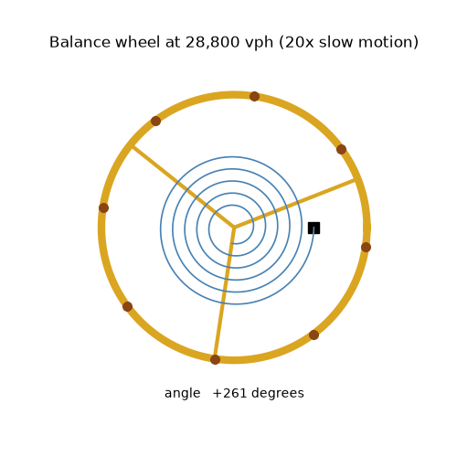
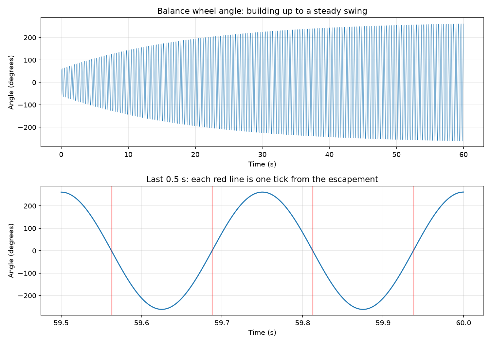
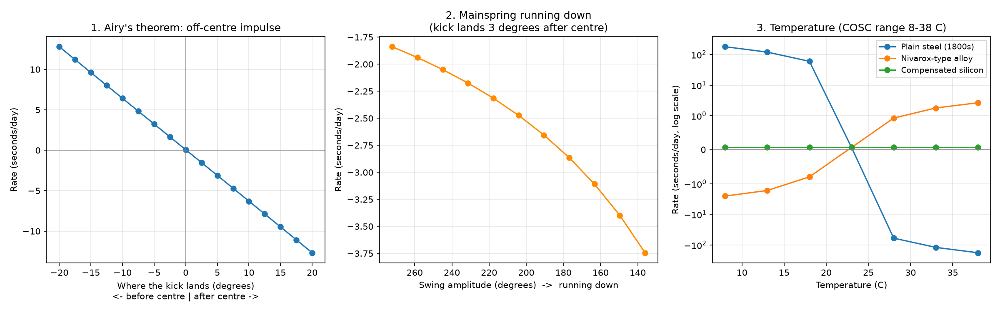

# balance-wheel-simulator
Physics simulation of a mechanical watch balance wheel and escapement: timekeeping, amplitude and temperature effects
# Balance Wheel Simulator

Physics simulation of a mechanical watch balance wheel and escapement: timekeeping, amplitude and temperature effects.



## The model

The balance wheel and hairspring are the timekeeping heart of a mechanical watch. This project models them as a **damped harmonic oscillator**:

- the **hairspring** pulls the wheel back towards the centre (restoring torque)
- **friction** slowly drains energy (quality factor Q = 250)
- the **escapement** gives the wheel a small kick of energy each time it swings through the centre, which is the "tick"

The watch beats at **28,800 vph** (8 ticks per second, 4 full swings per second). The equations are the same as an RLC circuit: the hairspring plays the capacitor, the wheel's inertia the inductor, and friction the resistor.

The equation of motion is integrated with a semi-implicit Euler method (time step 0.1 ms), and the escapement impulse is applied at the exact crossing point within each step.

## Part 1: the ticking oscillator (`balance_wheel.py`)

Starting from a small swing, the escapement builds the amplitude up until its kicks balance the friction losses, settling at about **270°**, a healthy amplitude for a real modern watch.



With the impulse delivered exactly at the centre, the simulated watch keeps perfect time (**+0.00 s/day**). This is **Airy's theorem** (1826): an impulse at the equilibrium point changes the amplitude but not the period.

## Part 2: what makes a watch gain or lose time (`experiments.py`)



| Experiment | Result |
|---|---|
| Impulse 10° **before** centre | **+6.4 s/day** (gains) |
| Impulse 10° **after** centre | **−6.3 s/day** (loses) |
| Fully wound (272° swing), impulse 3° late | −1.8 s/day |
| Half power (136° swing), impulse 3° late | −3.7 s/day |
| Plain steel hairspring, 8 °C → 38 °C | +180 → −180 s/day |
| Nivarox-type alloy, 8 °C → 38 °C | −2.5 → +2.7 s/day |
| Compensated silicon, 8 °C → 38 °C | +0.1 → +0.1 s/day |

1. **Airy's theorem:** the rate error is proportional to how far off-centre the impulse lands. Early impulses make the watch gain, late ones make it lose.
2. **Isochronism:** the same small escapement error matters more as the mainspring runs down and the swing gets smaller. The rate error roughly doubles when the amplitude halves.
3. **Temperature:** heat softens the hairspring and expands the balance wheel, both of which slow the watch. A plain steel hairspring is off by about 3 minutes a day across the COSC test range (8–38 °C). Self-compensating alloys and silicon hairsprings largely cancel this out.

## How to run

```bash
git clone https://github.com/dhiyakandhai-alt/balance-wheel-simulator.git
cd balance-wheel-simulator
python -m venv .venv
.venv\Scripts\activate        # on Mac/Linux: source .venv/bin/activate
pip install -r requirements.txt
python balance_wheel.py       # part 1: simulation, chart and animation
python experiments.py         # part 2: the three experiments
```

## Limitations

- The hairspring is treated as perfectly linear, and the escapement impulse is instantaneous. In a real lever escapement the impulse is spread over several degrees around the centre.
- The temperature coefficients are illustrative values chosen to show the scale of the effect for each material, not measured data.
- Positional errors (the effect of gravity when the watch is held in different orientations) are not modelled.